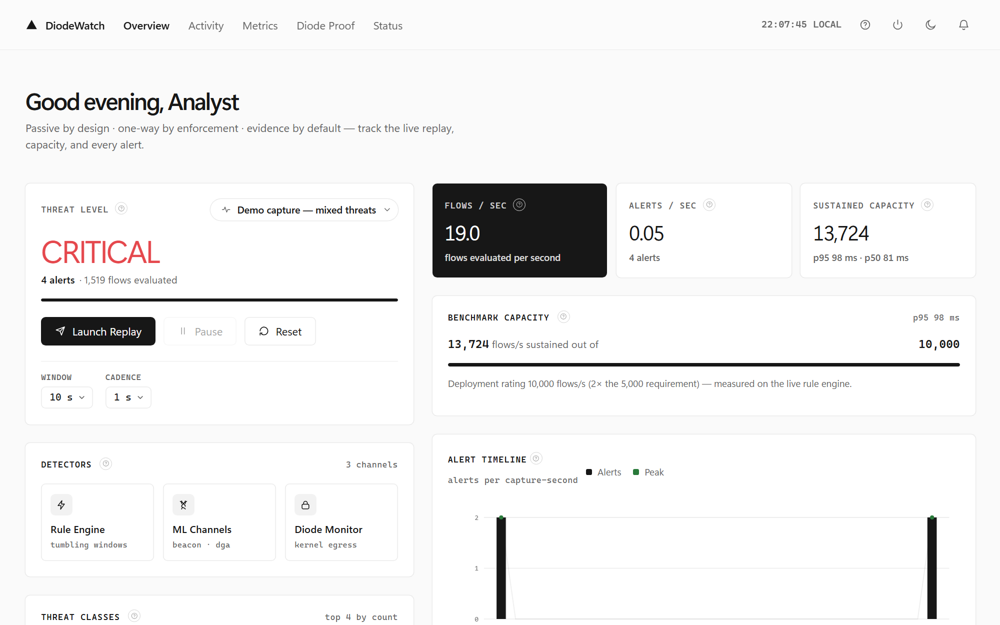
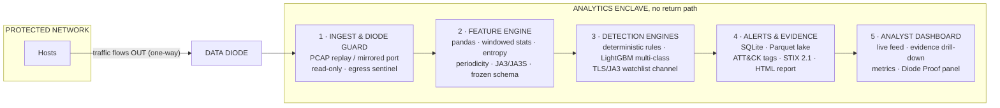
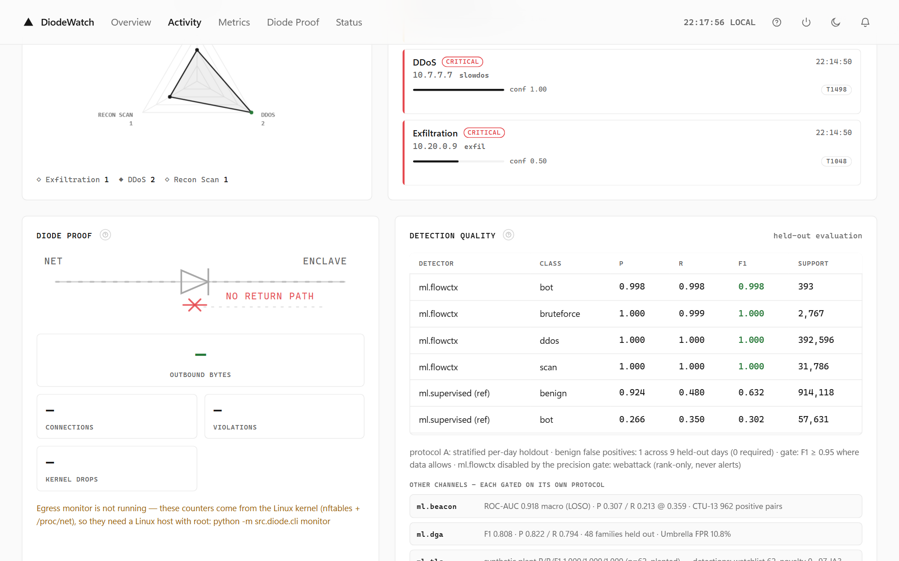
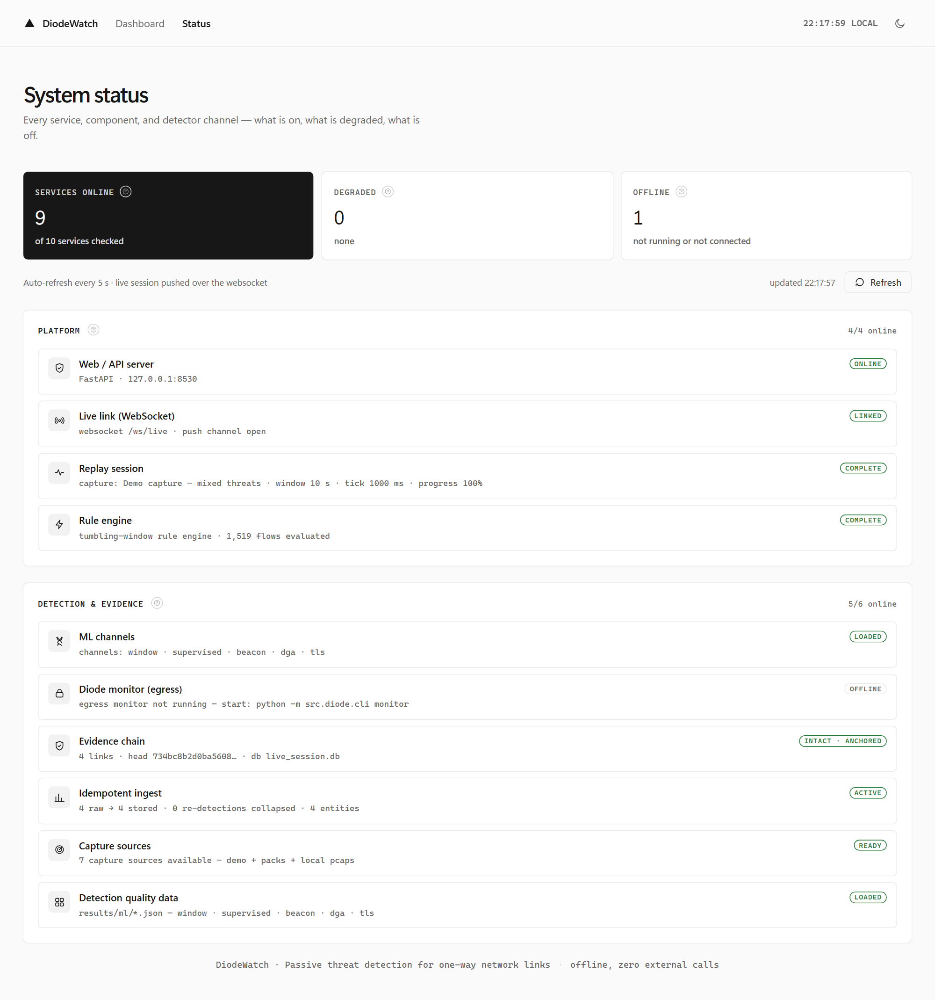

<div align="center">

# DiodeWatch

**Passive AI threat detection for one-way (data-diode) network links**


*Passive by design · One-way by enforcement · Evidence by default*

**[Status: what ships today, what is next, and what we do not do](docs/status.md)**

[Why DiodeWatch](#why-diodewatch) · [How it works](docs/pipeline.md) · [Architecture](#architecture) · [Proven results](#proven-results) · [Quick start](#quick-start) · [Docs](#documentation) · [Research references](#research-references)



</div>

---

## Why DiodeWatch

A classified or high-assurance network crosses a hardware **data diode** , 
monitoring data can flow out, but **nothing can ever flow back**. Conventional
NIDS tooling struggles in exactly the ways that matter here: no return path
means no active response, no inline blocking, no live source enrichment , 
so the entire detection stack must work **passively**, at line rate, on
one-way evidence alone.

DiodeWatch is built for that constraint from the ground up:

- **One-way-native detection.** Rules and ML that never assume they can talk
  back, no active probing, no handshake participation, no payload decryption
  (encrypted threats are classified from JA3/JA3S metadata, sizes, timing).
- **The diode itself is audited.** DiodeWatch verifies its own unidirectionality
  live: an egress sentinel + kernel rules keep outbound bytes at **zero**, and
  the dashboard's Diode Proof panel shows the counters in real time. If
  privileges are unavailable, the system **degrades loudly to monitor-only**
  with an explicit banner, never a silent fake zero.
- **SOC-grade evidence by default.** Every alert carries observed-vs-threshold
  proof, top-feature attribution, MITRE ATT&CK tags, and one-click
  **STIX 2.1** / HTML incident-report export.
- **Honest evaluation.** Out-of-sample metrics, pre-committed acceptance
  gates, a per-corpus drift report (PSI), and an automated claim guardrail
  that fails CI if judge-facing docs ever over-claim. Validated across
  **five public corpora, 50 files and 109,643,423 flows** from 2017-2019,
  plus cross-lab holdouts for the other channels (CTU-13 from CVUT for
  beaconing, Cisco Umbrella top-1M as an unseen benign set).

| # | Threat class | Primary one-way signals | ATT&CK |
|---|---|---|---|
| 1 | **Volumetric DDoS** | flow rate, packet-size entropy, byte volume, reflection asymmetry | T1498 |
| 2 | **Botnet C2 beaconing** | inter-arrival periodicity (FFT/autocorrelation), low-volume asymmetric flows | T1071.001 |
| 3 | **DNS tunnelling & DGA** | domain entropy, query rate, NXDOMAIN ratio, record-type diversity | T1568 |
| 4 | **Reconnaissance / scanning** | unique-port cardinality, TCP flag patterns, short-lived flows | T1046 |
| 5 | **Data exfiltration** | byte asymmetry, sustained single-destination volume, baseline deviation | T1048 |

Each class is an independent detector module, a new class plugs in without
touching the core pipeline.

---

## Architecture

Five one-way layers behind the diode:



| Layer | What it does |
|---|---|
| **1 · Ingest & Diode Guard** | PCAP replay or mirrored port → canonical bidirectional flows; kernel egress-deny + egress monitor prove one-way operation |
| **2 · Feature Engine** | Frozen 73-feature registry, pandas-vectorised, rates, entropy, periodicity, byte asymmetry, port-cardinality context, per-packet timing and size |
| **3 · Detection Engines** | Instant auditable rules (DDoS, slow-DoS, scan, exfil) + gated LightGBM channels; any channel failing its quality gate is disabled, never junk-scored |
| **4 · Alerts & Evidence** | ATT&CK-tagged envelope with observed-vs-threshold evidence, SQLite store, STIX 2.1 bundles, one-click HTML report |
| **5 · Analyst Dashboard** | Two UIs (Streamlit (`apps/dashboard/`) and an offline web mission-control (`apps/mission_control/`)) live feed, evidence drill-down, metrics, Diode Proof panel, plus a `/status` board listing every service's live state |

---

## Proven results

Measured, not promised, every number traces to `results/` or `docs/benchmarks.md`.

| Metric | Target | Measured |
|---|---|---|
| Sustained throughput | ≥ 5,000 flows/sec | **10,000 flows/s** on 4 cores / 8 GB (2× target) |
| Rule DDoS detection, full corpus | pre-committed F1 ≥ 0.95 | **PASS both: CIC-IDS2017 F1 0.962815, CIC-DDoS2019 F1 0.996426.** Alert-level scoring is weaker: CIC2017 exact precision 70/102 = 0.686 with 32 benign-only alerts, DDoS incident recall 41/51, scan 11/222 and slow-DoS 18/46; DDoS2019 exact precision 1,175/1,183 = 0.993 with 0 benign-only, but incident recall 1,175/9,927 = 0.118 and slow-DoS 0/448. The CIC2017 F1 margin over the gate is only 0.0128; the volume-versus-incident gap stays in [`max_scale.md`](docs/evaluation/runs/max_scale.md) |
| Benign false positives | pre-committed flow FPR ≤ 0.02 | **PASS both: 25,278/2,273,108 = 0.01112046 on CIC-IDS2017; 51/113,828 = 0.00044804 on CIC-DDoS2019.** The rule layer is still not clean on a mixed capture: 32 of 102 CIC2017 alerts land on benign-labelled windows. The ML flow-context channel is a different claim: 1 FP among 440,031 benign CIC-IDS2017 Wednesday flows, while the rule layer emits 43 alerts on that table and 3 land on benign windows ([rules.md](docs/rules.md#acceptance-reality)); the full-corpus alert counts are in [`max_scale.md`](docs/evaluation/runs/max_scale.md) |
| Detection latency | DDoS within 10 s | Detected within its **first 10-second window**; batch-amortized per-flow cost 0.03-0.07 ms |
| Outbound bytes to monitored side | 0 under enforcement | **0 on the enforced Linux path** across a 30-minute replay + idle run. Windows has no kernel egress-enforcement path, so the wall must show monitor-only there, not a fabricated zero |
| Validation breadth | - | **5 public corpora / 50 files / 109,643,423 flows (2017-2019).** Rules are evaluable on the two identity-bearing CIC corpora (CIC-IDS2017 and CIC-DDoS2019); CSE-CIC-IDS2018 and UNSW-NB15 have no identity columns, and CTU-13 is NetFlow with neither flow channel. Full transfer summary in [`docs/evaluation/transfer.md`](docs/evaluation/transfer.md) |

**What we deliberately don't claim:** the ML flow-context channel reports
recall 0.0 on the corpora it wasn't trained for, and publishes PSI drift as
the reason, it fails closed rather than guessing under distribution shift.
The full honesty ledger (including not-evaluable cells and a disclosed
leave-one-day-out threshold gap) is in [`docs/evaluation/transfer.md`](docs/evaluation/transfer.md).

---

## Quick start

One command on a **fresh Windows machine** (Python 3.10+, no admin, no Git
Bash, the offline wheelhouse below is built for **exactly CPython 3.11**, so
use 3.11 if the box is air-gapped):

```bat
git clone https://github.com/therayyanawaz/DiodeWatch.git
cd DiodeWatch
setup\setup.bat        :: creates .venv + installs pinned deps
run_demo.bat           :: analyst dashboard on http://localhost:8501
```

Linux / macOS / WSL:

```bash
git clone https://github.com/therayyanawaz/DiodeWatch.git
cd DiodeWatch
bash setup/setup.sh && bash run_demo.sh
```

The launcher verifies the environment, regenerates the demo pack offline in
seconds, and starts the dashboard. Useful variants:

```bash
run_demo.bat --port 8510              # pick a port
run_rehearsal.bat                     # headless pre-flight → "demo is GO"
setup\setup.bat --offline             # air-gapped install from setup\wheels\
.venv\Scripts\python.exe -m pytest tests/ -q   # full test suite
```

### Hardware requirements

| Profile | Spec | What runs |
|---|---|---|
| **Demo minimum** | 4 cores / 8 GB / ~3 GB disk / Python 3.10+ | Full demo: dashboard, live replay, all detectors |
| **Benchmark reference** | 4 cores / 8 GB | 10,000 flows/s sustained |
| **Production (Linux)** | same + root | Everything + kernel egress-deny (nftables) |

### Graceful degradation (by design)

| Restriction | Behaviour | How you know |
|---|---|---|
| No root / no admin | Everything runs; diode enforcement → **monitor-only** | Amber `MONITOR-ONLY` banner, never a silent fake zero |
| No network | Nothing breaks at runtime; setup installs from the offline wheelhouse | `setup.sh` auto-falls back to `setup/wheels/` |
| No trained models | Rule detectors still fire; the launcher restores the pinned beacon/DGA evaluation models when present, otherwise ML channels stay silent | Launcher names the retrain command |
| No datasets | Demo is fully synthetic and regenerates on the spot | Sidebar shows the generated capture |
| Same capture replayed twice | The evidence chain continues across restarts, so an alert already under custody is collapsed instead of re-shown as a fresh detection | Stat line reads "0 alerts · N re-detections collapsed"; `DIODE_LIVE_RESET=1` archives the old db + ledger as a pair and opens a clean chain |

---

## Air-gapped deployment

For a room with no internet, build the wheelhouse once on any networked
machine (same OS family; CPython 3.11-specific, ~250 MB for win_amd64) and
ship the repo **including `setup/wheels/`**:

```bash
pip download -r requirements.txt -d setup/wheels --python-version 3.11 --only-binary=:all:
```

Then at the air-gapped site: `setup\setup.bat --offline` → `run_rehearsal.bat`
(expect "demo is GO") → `run_demo.bat`. Streamlit usage telemetry should be
disabled on classified boxes (`~/.streamlit/config.toml` →
`[browser] gatherUsageStats = false`); the application itself makes zero
external calls. Full runbook: `docs/diode.md`, `docs/dashboard.md`.

---

## Documentation

| Doc | Contents |
|---|---|
| **[`docs/pipeline.md`](docs/pipeline.md)** | **Start here.** The whole system explained in order, from an empty folder to an analyst's alert: every stage with the file that owns it, a worked DDoS trace, the measured numbers, a glossary, and what the project deliberately does not do |
| [`docs/diode.md`](docs/diode.md) | Diode architecture, enforcement modes, honest-degradation contract |
| [`docs/benchmarks.md`](docs/benchmarks.md) | Throughput ladder, accuracy gates, methodology |
| [`docs/ml.md`](docs/ml.md) | What trains on what, out-of-sample protocols, gates, design decisions |
| [`docs/models/`](docs/models/README.md) | Model cards for the two shipped artifacts: what each reads, what it decides, its provenance, its limits, and the digest of the exact bytes in the tree |
| [`docs/rules.md`](docs/rules.md) | Rule detectors and their thresholds |
| [`docs/alerts.md`](docs/alerts.md) | Alert schema, evidence model, STIX/report export |
| [`docs/threat-model.md`](docs/threat-model.md) | Trust boundaries in STRIDE, what is implemented at each, what is deliberately out of scope, and the test that re-checks every claim |
| [`docs/laya.md`](docs/laya.md) | Laya System-1 triage channel, offline ONNX decision model (advisory) |
| [`docs/features.md`](docs/features.md) | Frozen 73-feature registry + parity validation |
| [`docs/dashboard.md`](docs/dashboard.md) | Both analyst surfaces: the `:8530` mission-control wall (routes, which owner computes each on-screen number, caps, status board, and the `frontend/` React client its `/` and `/status` pages are built from) and the Streamlit dashboard with its Diode Proof panel |
|  | *Diode Proof panel, one-way link diagram and egress counters. Captured on a host without the egress monitor: the counters stay empty and say why, never a silent fake zero.* |
|  | *`/status`, every service, component, and detector channel with its live state, derived from the same APIs the dashboard reads* |
| [`docs/demo_script.md`](docs/demo_script.md) | Narrated 3-5 minute live demonstration script |
| [`docs/datasets.md`](docs/datasets.md) | Dataset register with SHA256 provenance |
| [`AUTHORS.md`](AUTHORS.md) | The six people, the area each one owns, and the file tree that ownership maps to |
| [`docs/evaluation/`](docs/evaluation/README.md) | Cross-corpus transfer evaluation, committed snapshot (both phases, gates, limitations, per-run JSON) |
| [`docs/roadmap.md`](docs/roadmap.md) | The thirteen-week schedule each release was cut on, week by week, with what shipped in it |

---

## Origin & validation

DiodeWatch was engineered for **Smart India Hackathon 2026**, problem
statement *AI-Based Detection of Cyber Threats in Unidirectional IP Traffic*,
sponsored by **NTRO** (National Technical Research Organisation), and its
evaluation discipline (pre-committed gates, cross-corpus transfer testing,
drift reporting, claim guardrail) is a direct product of that bar. The
competition-maintainer brief ([`docs/competition/judge-brief.md`](docs/competition/judge-brief.md))
and the readiness ledger ([`docs/competition/readiness.md`](docs/competition/readiness.md))
are both in the repository: the brief is the one-page answer to "what is this
and why does it hold up", the ledger is the item-by-item record behind it.

## Research references

Every research work this system is trained on, validated against, or built to
spec, with its link, grouped as datasets, methods and models, standards and
dependencies. Nothing here is decorative: each row names what the project
actually consumes from it, and every corpus is pinned by URL + SHA256
in [`docs/datasets.md`](docs/datasets.md) before it touches training or
benchmarking.

### Datasets

| Corpus | Published in | Link | Used here by |
|---|---|---|---|
| **CIC-IDS2017**, plus the CICFlowMeter feature schema our engine is parity-checked against | Sharafaldin, Lashkari & Ghorbani, *Toward Generating a New Intrusion Detection Dataset and Intrusion Traffic Characterization*, ICISSP 2018, pp. 108-116 | [doi:10.5220/0006639801080116](https://doi.org/10.5220/0006639801080116) | 8 training days; the parity table in [`docs/features.md`](docs/features.md) |
| **CIC-DDoS2019** | Sharafaldin, Lashkari, Hakak & Ghorbani, *Developing Realistic Distributed Denial of Service (DDoS) Attack Dataset and Taxonomy*, IEEE 53rd International Carnahan Conference on Security Technology (ICCST), 2019 | [doi:10.1109/CCST.2019.8888419](https://doi.org/10.1109/CCST.2019.8888419) | the zero-shot DDoS transfer day in [`docs/evaluation/transfer.md`](docs/evaluation/transfer.md) |
| **CSE-CIC-IDS2018** | **No dedicated dataset paper exists.** UNB's licence requires citing the dataset and its page, and points to the ICISSP 2018 method paper above for the generation method | [unb.ca/cic/datasets/ids-2018.html](https://www.unb.ca/cic/datasets/ids-2018.html) | 4 cross-year transfer days |
| **CTU-13** botnet scenarios | García, Grill, Stiborek & Zunino, *An empirical comparison of botnet detection methods*, Computers & Security 45:100-123, 2014 (the citation the Stratosphere lab asks for) | [doi:10.1016/j.cose.2014.05.011](https://doi.org/10.1016/j.cose.2014.05.011) | beaconing leave-one-scenario-out in [`src/detectors/ml/beacon.py`](src/detectors/ml/beacon.py) |
| **UNSW-NB15** | Moustafa & Slay, *UNSW-NB15: a comprehensive data set for network intrusion detection systems (UNSW-NB15 network data set)*, IEEE Military Communications and Information Systems Conference (MilCIS), 2015 | [doi:10.1109/MilCIS.2015.7348942](https://doi.org/10.1109/MilCIS.2015.7348942) | fetched as a transfer target; carries no headline metric claim |
| **DGA corpus** (`argencon.csv.gz`: 1,915,335 DGA domains / 51 families + 1,003,161 benign) | Catania, García & Torres, *Deep Convolutional Neural Networks for DGA Detection*, CACIC 2018, Communications in Computer and Information Science 1038:327-340, Springer 2019 | [doi:10.1007/978-3-030-20787-8_23](https://doi.org/10.1007/978-3-030-20787-8_23) | DGA training + family-holdout CV in [`src/detectors/ml/dga.py`](src/detectors/ml/dga.py) |
| ↳ the original 51-family crawl that corpus is built from, and where the filename comes from | Erquiaga, Catania & García, *Detecting DGA malware traffic through behavioral models*, 2016 IEEE Biennial Congress of Argentina (ARGENCON), pp. 1-6 | [doi:10.1109/ARGENCON.2016.7585238](https://doi.org/10.1109/ARGENCON.2016.7585238) | same corpus lineage |
| ↳ the redistribution we actually download (CC-BY-2.0) | Hugging Face dataset `harpomaxx/dga-detection`, derived from Abakumov's DGA family repositories and the Bambenek Consulting feeds | [huggingface.co/datasets/harpomaxx/dga-detection](https://huggingface.co/datasets/harpomaxx/dga-detection) | fetched by [`scripts/fetch/download_ml_corpora.py`](scripts/fetch/download_ml_corpora.py) |
| **Cisco Umbrella top-1M** (a list, not a paper) | Cisco Open Data | [umbrella-static/top-1m.csv.zip](https://s3-us-west-1.amazonaws.com/umbrella-static/top-1m.csv.zip) | the never-trained-on benign holdout behind the DGA FPR figure |
| **abuse.ch SSLBL JA3 blacklist** (a feed, not a paper) | abuse.ch | [sslbl.abuse.ch/blacklist](https://sslbl.abuse.ch/blacklist/) | the 97 pinned hashes in [`docs/evaluation/tls/ja3_fingerprints.csv`](docs/evaluation/tls/ja3_fingerprints.csv) |

### Methods, algorithms and models

| What we use | Published in | Link | Where |
|---|---|---|---|
| LightGBM gradient boosting (every supervised channel) | Ke et al., *LightGBM: A Highly Efficient Gradient Boosting Decision Tree*, NeurIPS 2017 | [papers.nips.cc/paper/6907](https://papers.nips.cc/paper/6907-lightgbm-a-highly-efficient-gradient-boosting-decision-tree) | `src/detectors/ml/` |
| Isolation Forest (TLS novelty layer) | Liu, Ting & Zhou, *Isolation Forest*, IEEE International Conference on Data Mining (ICDM), 2008, pp. 413-422 | [doi:10.1109/ICDM.2008.17](https://doi.org/10.1109/ICDM.2008.17) | [`src/detectors/ml/tls_ja3.py`](src/detectors/ml/tls_ja3.py) |
| Shannon entropy (domain, packet-size and port-distribution features) | Shannon, *A Mathematical Theory of Communication*, Bell System Technical Journal 27:379-423 & 623-656, 1948 | [doi:10.1002/j.1538-7305.1948.tb01338.x](https://doi.org/10.1002/j.1538-7305.1948.tb01338.x) | [`src/features/`](src/features/specs.py) |
| PSI drift reporting (why a channel fails closed on a new lab) | Yurdakul & Naranjo, *Statistical properties of the population stability index*, The Journal of Risk Model Validation 14(4):89-100, 2020 | [doi:10.21314/JRMV.2020.227](https://doi.org/10.21314/JRMV.2020.227) | `psi()` in [`scripts/benchmarks/bench_transfer.py`](scripts/benchmarks/bench_transfer.py) |
| JA3 / JA3S TLS fingerprinting (metadata only, so the no-decryption rule holds) | Althouse, Atkinson & Atkins, 2017. The original SANS whitepaper URL is now dead, so the primary live sources are the open-sourcing post and the reference implementation | [Open Sourcing JA3](https://engineering.salesforce.com/open-sourcing-ja3-92c9e53c3c41/) · [salesforce/ja3](https://github.com/salesforce/ja3) | [`src/detectors/ml/tls_ja3.py`](src/detectors/ml/tls_ja3.py) |
| ModernBERT encoder inside the Laya triage model | Warner, Chaffin, Clavié et al., *Smarter, Better, Faster, Longer: A Modern Bidirectional Encoder for Fast, Memory Efficient, and Long Context Finetuning and Inference*, arXiv:2412.13663, 2024 | [arxiv.org/abs/2412.13663](https://arxiv.org/abs/2412.13663) | [`src/triage/laya_runtime.py`](src/triage/laya_runtime.py) |
| RLCD, the calibration objective Laya was trained with | Guo et al., *Just Ask Jev: Reinforcement Learning for Calibrated Decisions as a Zero-Shot Detector of AI Alignment Failures*, arXiv:2609.29429, 2026. Open reimplementation: Gao & Wang, *OpenJev-RLCD: A Working RLCD Implementation*, arXiv:2609.38850, 2026 | [arxiv.org/abs/2609.29429](https://arxiv.org/abs/2609.29429) · [arxiv.org/abs/2609.38850](https://arxiv.org/abs/2609.38850) | [`docs/laya.md`](docs/laya.md) |
| Laya itself (Convai Innovations, Apache-2.0 weights) | **No paper or technical report exists** for Laya; the model card is the primary source, alongside the TypeScript port our Python port follows | [convaiinnovations/laya](https://huggingface.co/convaiinnovations/laya) · [receptron/laya](https://github.com/receptron/laya) | [`src/triage/`](src/triage/laya_runtime.py) |

### Standards and frameworks

Normative documents rather than research papers, but the code is written
against them, so they belong in the same list.

| Spec | Published by | Link | Where |
|---|---|---|---|
| STIX 2.1 (Structured Threat Information eXpression) | OASIS Cyber Threat Intelligence Technical Committee | [stix-v2.1-os](https://docs.oasis-open.org/cti/stix/v2.1/os/stix-v2.1-os.html) | hand-built bundle in [`src/alerts/export_stix.py`](src/alerts/export_stix.py) |
| MITRE ATT&CK technique/tactic model | Strom, Applebaum, Miller, Nickels, Pennington & Thomas, *MITRE ATT&CK: Design and Philosophy*, The MITRE Corporation, revised March 2020 | [PDF](https://attack.mitre.org/docs/ATTACK_Design_and_Philosophy_March_2020.pdf) · [matrix](https://attack.mitre.org/) | ATT&CK tags on every alert, [`src/alerts/schema.py`](src/alerts/schema.py) |
| ModSecurity v3 rule language | OWASP / Trustwave | [modsecurity.org](https://www.modsecurity.org/) | [`waf/modsecurity.conf`](waf/modsecurity.conf) |
| OWASP Top 10 categories used as WAF rule tags | OWASP Foundation | [top10.owasp.org](https://top10.owasp.org/) | rule tags in `waf/modsecurity.conf` |
| Zeek `dns.log` / `ssl.log` record formats | Zeek Project. The framework (formerly Bro) has a real paper behind those record semantics: Paxson, *Bro: A System for Detecting Network Intruders in Real-Time*, Computer Networks 31(23-24):2435-2463, 1999 | [zeek.org](https://zeek.org/) · [doi:10.1016/S1389-1286(99)00112-7](https://doi.org/10.1016/S1389-1286(99)00112-7) · [USENIX Security '98 version](https://www.usenix.org/legacy/publications/library/proceedings/sec98/full_papers/paxson/paxson.pdf) | the TLS/DNS feature inputs the registry declares as `future` |
| TAXII 2.1, the transport a STIX bundle is published to | OASIS Cyber Threat Intelligence Technical Committee, OASIS Standard, 10 June 2021 | [taxii-v2.1-os](https://docs.oasis-open.org/cti/taxii/v2.1/os/taxii-v2.1-os.html) | the downstream consumer named in [`src/alerts/export_stix.py`](src/alerts/export_stix.py) |

### Software the pipeline runs on

The pinned dependencies in [`requirements.txt`](requirements.txt), and whether
each one actually has a research paper behind it. Four do (numpy, pandas,
scikit-learn and LightGBM); the rest do not, and inventing a citation for a
library whose maintainers ask for a plain software record would be worse than
saying so.

| Dependency | Publication | Link | Paper? |
|---|---|---|---|
| **numpy** `>=1.26` | Harris, Millman, van der Walt, Gommers et al., *Array programming with NumPy*, Nature 585:357-362, 2020 | [doi:10.1038/s41586-020-2649-2](https://doi.org/10.1038/s41586-020-2649-2) · [arXiv:2006.10256](https://arxiv.org/abs/2006.10256) | Yes |
| **pandas** `>=2.2` | The maintainers' `CITATION.cff` asks for the Zenodo software record, not a paper. The method paper is McKinney, *Data Structures for Statistical Computing in Python*, Computing in Science & Engineering 12(3):56-63, 2010 | [Zenodo: 10.5281/zenodo.3509134](https://doi.org/10.5281/zenodo.3509134) · [doi:10.1109/MCSE.2010.118](https://doi.org/10.1109/MCSE.2010.118) | Software record + one paper |
| **scikit-learn** `==1.9.0` (IsolationForest, LabelEncoder, metrics) | Pedregosa, Varoquaux, Gramfort, Michel et al., *Scikit-learn: Machine Learning in Python*, Journal of Machine Learning Research 12:2825-2830, 2011 | [jmlr.org/papers/v12/pedregosa11a](https://jmlr.org/papers/v12/pedregosa11a.html) | Yes |
| **lightgbm** `>=4.3` | Ke et al., NeurIPS 2017, already listed under Methods (it is a detection engine here, not just a dependency) | [see above](#methods-algorithms-and-models) | Yes |
| **scapy** `>=2.5`, **pyarrow**, **joblib**, **onnxruntime**, **tokenizers**, **huggingface_hub**, **streamlit**, **fastapi**, **uvicorn** | **No paper exists.** ONNX Runtime's `CITATION.cff` is `type: software` with no DOI and no paper behind it, and the separate ONNX *format* work is a different project, so neither is credited here. Scapy, tokenizers, huggingface_hub, Streamlit, FastAPI and uvicorn likewise ship no citable research | [scapy.net](https://scapy.net/) | No |
| **polars** `>=1.0`, **scipy** `>=1.11` | **Not cited on purpose.** No module in this tree imports either one (`git log -S` finds polars only in `requirements.txt`, added in the initial commit, and the feature engine is pandas). SciPy has a genuine paper, Virtanen et al., *SciPy 1.0*, Nature Methods 17:261-272, 2020, that this project has not earned by using it. Both stay off the list until the code does | - | n/a |

**Not claimed as research:** the inter-arrival periodicity features
(FFT/autocorrelation), the leave-one-day-out and leave-one-scenario-out
protocols, and the family-holdout cross-validation are standard evaluation
practice. They are described in [`docs/ml.md`](docs/ml.md) as our own
methodology, and no paper is credited for them.

## License

Proprietary, all rights reserved. Source is published for **evaluation
purposes only**; commercial licensing is available, open a
[GitHub issue](https://github.com/therayyanawaz/DiodeWatch/issues/new?title=Commercial%20license%20inquiry)
or a [private security advisory](https://github.com/therayyanawaz/DiodeWatch/security/advisories/new)
to start the conversation. See [`LICENSE`](LICENSE).

## Attribution

Built for Smart India Hackathon 2026 under a problem statement from NTRO.
Research data used with attribution: UNB Canadian Institute for
Cybersecurity (CIC-IDS2017, CIC-DDoS2019, CSE-CIC-IDS2018); CTU-13 for
beaconing; Cisco Umbrella top-1M for benign domains; abuse.ch JA3 watchlist.
Full bibliography with links in [Research references](#research-references).
No proprietary or PII-bearing data is ingested anywhere in the pipeline.
