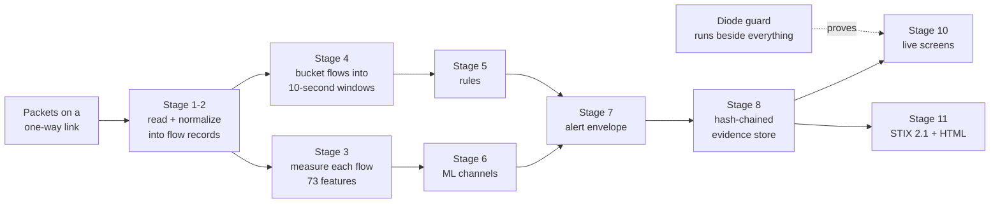

# How DiodeWatch works, from an empty folder to an analyst's alert

This is the whole machine explained in order, in plain words, with the file that
implements each step named beside it. It assumes no networking background. Every
jargon word is defined the first time it appears, and the glossary at the end
collects them all.

Read it top to bottom once. After that it works as a map: each stage stands on
its own, so you can jump to the one you are touching.

**Related docs:** [diode.md](diode.md) · [features.md](features.md) ·
[ml.md](ml.md) · [rules.md](rules.md) · [alerts.md](alerts.md) ·
[dashboard.md](dashboard.md) · [benchmarks.md](benchmarks.md) ·
[laya.md](laya.md)

---

## The 60-second version

Something crosses a network link that only goes one way. DiodeWatch reads a copy
of that traffic, groups the individual packets into conversations (called
*flows*), measures each conversation into 73 numbers, and asks two kinds of
question about them:

1. **Rules** ask fixed, human-readable questions. "Is one machine receiving more
   than 50 new conversations per second?" A rule answers yes or no and prints
   the number it saw next to the number it was told to watch.
2. **Models** ask learned questions. A model was shown millions of labelled
   conversations first, so it answers with a probability instead of a yes/no.

When either one says something looks like an attack, DiodeWatch writes an
**alert**. An alert is not just a notification. It is a sealed piece of evidence:
what fired, the observed value, the threshold, the time window, the attacker and
victim addresses, and a MITRE ATT&CK label. Alerts go into a SQLite database
that is chained with hashes so a changed record is detectable, and they show up
on two live screens. One button turns any alert into a STIX 2.1 bundle, the
format another agency's security system can ingest.

Running beside all of this, a small component proves that DiodeWatch itself has
sent **zero packets back** into the network it watches. That proof is on the
screen too, and if the machine cannot observe it, the screen says so instead of
showing a fake zero.

---

## 1. The constraint that shapes every design choice

A **data diode** is a hardware link that physically allows data one way only. A
classified or high-assurance network uses one to push monitoring data *out* to an
analytics enclave. Nothing can come back in. Not a reply, not a reset, not an
acknowledgement.

That single fact breaks the usual security tooling in four specific ways:

| What a normal NIDS relies on | Why it is unavailable here |
|---|---|
| Blocking or resetting a connection inline | There is no return path, so no packet can be sent back |
| Asking a source for more detail (active probing, re-reading a flow) | Any question you ask needs an outbound connection |
| Decrypting payloads to look inside | The session keys live on the protected side and cannot be retrieved |
| Enriching from a live external feed | No outbound calls are permitted from the enclave |

So everything must be decided from **metadata that already flowed out**, passively,
at line rate, with no second chances. That is the entire problem this project is
built around, and it is why the feature set is sizes, counts, rates, timing,
directions, ports and fingerprints rather than content.

**Flow** is the word you need before going further. A flow is one conversation
between two endpoints: "192.168.10.14 port 49459 talked to 209.48.71.168 port 80
over TCP for 3.2 seconds, sent 1,200 bytes in 12 packets, got 48,000 bytes back
in 40 packets." The five facts that identify it (source address, source port,
destination address, destination port, protocol) are the **5-tuple**. A **packet**
is one single piece of one conversation, so a flow is a group of packets.

---

## 2. The whole machine at once



| Layer | Job in one sentence | Code |
|---|---|---|
| **1 · Ingest & Diode Guard** | Turn whatever arrived into one honest flow record per conversation, and prove nothing left | [src/ingest/](../src/ingest), [src/diode/](../src/diode) |
| **2 · Feature Engine** | Measure each flow into a fixed set of numbers that never changes between runs | [src/features/](../src/features) |
| **3 · Detection Engines** | Ask rule questions and model questions, and disable any channel that fails its quality gate | [src/detectors/](../src/detectors) |
| **4 · Alerts & Evidence** | Wrap every detection in auditable evidence, store it tamper-evidently, export it | [src/alerts/](../src/alerts) |
| **5 · Analyst Dashboard** | Show it live, on two offline screens, with the diode proof beside the alerts | [apps/](../apps) |

---

## 3. Stage by stage

Each stage below lists what comes in, what goes out, and what actually happens.
Follow them in order and you have watched one packet become an incident report.

---

### Stage 0. An empty folder becomes a working system

**In:** a fresh machine. **Out:** an environment that can run everything, offline.

`setup\setup.bat` (Windows) or `bash setup/setup.sh` (Linux/macOS) creates a
private Python environment in `.venv/` and installs the pinned dependencies. For
an air-gapped room, `setup\setup.bat --offline` installs from `setup\wheels\`
instead of the internet, and `setup.sh` falls back to that wheelhouse by itself
when there is no network.

Then `run_demo.bat` does four things in order, and each one is worth knowing
because it explains a behaviour you will otherwise see on screen:

1. It verifies `.venv` by running `setup/setup.sh --check`, and repairs it if a
   package is missing.
2. It regenerates the demo captures offline if they are absent
   ([scripts/generators/make_demo_pack.py](../scripts/generators/make_demo_pack.py)),
   in seconds, from a fixed recipe. No datasets are needed to run the demo.
3. If `models/` is empty but the pinned evaluation models exist under
   `docs/evaluation/models/`, it copies them back in, which is what enables the
   C2-beacon and DGA channels. If there is nothing to copy, it **warns** and the
   ML channels stay silent while the rules still fire.
4. It launches the dashboard.

Two facts about this stage that matter later:

* The wheelhouse is built for exactly CPython 3.11, so an air-gapped install
  wants 3.11.
* `requirements.txt` pins scikit-learn to one exact version because the model
  files in `models/` are pickles written by that version, and a pickle from one
  scikit-learn is not guaranteed to load in another.
  [tests/test_ml_provenance.py](../tests/test_ml_provenance.py)
  fails if the pin and the shipped artifacts disagree.

---

### Stage 1. Packets arrive, and get grouped into conversations

**In:** a `.pcap`/`.pcapng` capture, or a CICFlowMeter-style `.csv`/`.parquet` table.
**Out:** one bidirectional flow per conversation.
**Code:** [src/ingest/pcap_reader.py](../src/ingest/pcap_reader.py)

For a capture, scapy is opened as a **streaming reader** (`PcapReader` /
`PcapNgReader`), so a 20 GB file never becomes 20 GB of RAM. Packets are pulled
one at a time and three decisions happen per packet:

1. **Is it IP at all?** The reader looks for an IPv4 or IPv6 layer, takes the
   protocol number, and pulls TCP or UDP ports and TCP flag bits if present. A
   packet with no IP layer is skipped, but counted, so the summary line can
   honestly report `packets=… ip=… skipped=…`.
2. **Which conversation does it belong to?** The flow key is built by sorting the
   two endpoints
   ([`_endpoint_key`](../src/ingest/pcap_reader.py#L68)).
   Sorting means direction does not matter, so a request and its reply fold into
   the same record instead of appearing as two separate conversations. This is
   what makes "how much came back" measurable at all, and asymmetry is the signal
   behind most of the detections later on.
3. **Is it forward or backward traffic?** If the packet's source matches the flow's
   recorded source, it counts into `fwd_pkts`/`fwd_bytes`; otherwise into
   `bwd_pkts`/`bwd_bytes`. "Forward" is simply *the direction the first packet
   went*, which is why the reply channel is "backward".

A flow **closes** when it has been silent for `flow_timeout` seconds (120 by
default, matching CICFlowMeter's own semantics). If the same 5-tuple comes back to
life after that gap, it starts a new record rather than stretching the old one.
At end of file, whatever is still open is flushed in order of first appearance.

Because the grouper already sees every packet clock, it stamps the record it
closes: `timestamp` is the first packet's time in ISO-8601 UTC, for a PCAP as
surely as for a published flow table. Before that, a capture-derived flow carried
a null there, which quietly disqualified it from every time-ordered path downstream
— chronological splits, sliding windows, an alert you could place on a clock.

The consequence worth remembering: this stage keeps **no payload bytes at all**.
Only sizes, counts, timings, ports, protocol numbers and TCP flag counts survive.
That is not a shortcut, it is the design. If a threat is encrypted, DiodeWatch
never needs the key, because it was never planning to read the body.

---

### Stage 2. Every source becomes the same 47 fields

**In:** packets, or a table with any column dialect. **Out:** NDJSON, one flow per
line, with exactly the same keys every time.
**Code:** [src/ingest/schema.py](../src/ingest/schema.py),
[src/ingest/unify.py](../src/ingest/unify.py)

Real published captures are messy in a specific way: the same field appears as
`Destination Port`, `" Destination Port"` (leading space), `Dst Port`, or
`Total Length of Fwd Packets` versus `Total Length of Fwd Packet`. Some mirrors
store an IP address as a giant decimal integer. Timestamps appear in at least
seven different formats.

`normalize_column()` strips a header cell to lowercase alphanumerics and looks it
up in `COLUMN_ALIASES`; anything unmatched is ignored rather than guessed at.
`to_ip()` accepts dotted-quad, IPv6, and the decimal form (so `3232238089`
becomes `192.168.1.9`). `to_timestamp()` tries seven formats and returns both an
ISO-8601 string and an epoch float. Naive timestamps are treated as the source
clock and tagged UTC so ordering stays consistent.

The null discipline is deliberate: `to_int()` returns `None` for blanks, NaN,
infinities and junk instead of inventing a zero. `FLOW_FIELDS` has 47 keys and
both readers emit exactly them, which is why nothing downstream ever contains a
branch about where the data came from. The 47 are 21 identity-and-count fields plus
26 per-packet timing and size statistics: a PCAP flow gets them because the reader
measures them from the packets it saw, a flow-table record gets them because the
publisher already measured them — either way the same keys, and a statistic no
source supplied stays NaN rather than becoming a suspicious-looking zero.

`unify.py` is the CLI. `--input` may be a single file or a directory, processed in
sorted order and concatenated. `--format` forces a reader instead of inferring
from the suffix. `python -m src.ingest.unify --input data/raw/ --out
data/slices/flows.ndjson` is Stage 1 and 2 in one command, and it prints the label
tally at the end.

---

### Stage 3. Each flow is measured into 73 fixed numbers

**In:** flow records. **Out:** one row per flow, 73 columns, always in the same
order.
**Code:** [src/features/specs.py](../src/features/specs.py),
[src/features/engine.py](../src/features/engine.py),
[src/features/pipeline.py](../src/features/pipeline.py)

`specs.py` is the **registry**: a list of every column, its family, its dtype, and
a one-line description. It is the single source of truth, used both to build the
frame and to write the documentation, which is why the count cannot silently
drift. Today: **73 active** columns and 6 more *declared but not yet emitted*.

| Family | Count | What it captures |
|---|---:|---|
| meta | 9 | identity and provenance (flow id, addresses, ports, protocol, timestamp, label). Never model inputs |
| basic | 10 | duration, packet and byte counts in each direction, mean packet sizes |
| rates | 6 | throughput per direction and total, in bytes/s and packets/s |
| ratio | 3 | directional asymmetry: how much more went one way than the other |
| protocol | 3 | `is_tcp`, `is_udp`, `is_icmp` |
| tcpflags | 6 | count of packets carrying each TCP flag |
| dns | 1 | `is_dns`: either endpoint is port 53 |
| context | 9 | group statistics: how many flows this source ran, how many distinct ports and hosts it touched, the **entropy** of its port choices, its DNS share, and the same view from the destination side |
| iat | 14 | inter-arrival time in microseconds: mean, spread, extremes over the whole flow and separately over each direction |
| pktlen | 12 | per-packet size in bytes: min, max, mean, standard deviation over the whole flow and separately over each direction |

The 26 `iat`/`pktlen` columns are a different kind of citizen from the rest: the
ingest stage already holds the per-packet clock and per-packet sizes, so it folds
them into the record itself (Welford accumulators, one pass, no packet list kept)
and the engine passes them through unchanged rather than recomputing them from
aggregates that have already lost the shape. On a CIC table they arrive pre-folded
and are carried straight across, which is what lets `spotcheck_features.py` compare
every one of them to the source column exactly.

38 of the 73 columns are the model inputs. The 9 meta columns ride along for
joins, evaluation and alerting, and are deliberately excluded from any feature
matrix; so are the 26 timing and size columns, because the pinned models were
trained before they existed and their fingerprint check would refuse the new
matrix. They are emitted, documented and parity-checked today, and they are the
first thing a retrain picks up.

Three behaviours here are worth understanding because they prevent whole classes
of wrong answers:

**Divide-by-zero becomes NaN, never infinity.** [`_safe_divide()`](../src/features/engine.py#L31)
returns NaN when the divisor is zero. A flow with zero duration has an *undefined*
rate, not an infinitely large one. This matters because an infinity in a rate
column would max out every threshold and manufacture an attack summary out of a
capture quirk. LightGBM and pandas both handle NaN natively, so nothing needs a
guard downstream.

**Context features are computed across the whole batch.** "How many distinct
destination ports did this source contact" is not a property of one flow, so it
needs to see its neighbours. The engine does it with vectorized `groupby`
transformations, including a Shannon entropy of each source's destination-port
distribution ([`_group_value_entropy()`](../src/features/engine.py#L47)).

**Entropy** appears twice in this project and means the same thing both times: how
spread-out a set of choices is. A load balancer touching ports 80, 443 and 8080
has low port entropy. A scanner hitting 300 random ports has high port entropy. A
human-readable domain like `github.com` has low character entropy; a
machine-generated one like `x7kq2pw9z.net` has high.

The declared-future entries are honest placeholders in the schema, not code. The
four DNS and TLS ones name what the pipeline *would* consume if it had Zeek `dns.log`
and `ssl.log` (domain length and entropy, NXDOMAIN rate, JA3/JA3S fingerprints), and
`active_idle_*` stayed future on evidence: measured against the pinned CIC slice,
the burst floor that separates an active period from an idle one is 5,000,002 µs,
but the aggregation on top of it reproduces only 98.13% of the published columns,
so this project refuses to emit a column whose name would mean two different things
depending on who computed it. They are excluded from `ACTIVE_NAMES`, so no model
ever sees a column that does not exist.

`pipeline.py` writes the result as Parquet and prints the per-family column counts,
so a registry change is visible in the run log rather than in a diff.

---

### Stage 4. Flows get bucketed into 10-second windows

**In:** flow records. **Out:** two tables, one per destination and one per source.
**Code:** [src/detectors/window.py](../src/detectors/window.py)

Rules do not look at flows one at a time, because attacks are *rate and cardinality*
phenomena. A single SYN packet means nothing; 4,000 half-open SYNs to one target in
ten seconds is an attack. So flows are bucketed into **tumbling windows**
(disjoint, back-to-back 10-second bins), computed as `ts_epoch // 10`.

Two views come out of every batch, because the two questions are asked from
different sides of the conversation:

**Per destination** (one row per window + target IP) is where denial-of-service
signals live. Aggregates include flow count, distinct source count, forward and
backward packet/byte sums, mean and max duration, held connections, UDP share, and
SYN/ACK/RST packet sums. From those, derived columns give `flows_per_sec`,
`fwd_bytes_per_sec`, the forward/backward packet ratio, mean forward packet size,
`syn_share`, `half_open` (SYNs minus ACKs, clipped at zero: unanswered
handshakes) and `src_conc` (distinct sources divided by the flow count, so a **low**
value means each source is hammering the target repeatedly rather than sending one
probe each).

**Per source** (one row per window + originating IP) is where scanning and
exfiltration signals live. Aggregates include distinct destination ports and hosts
touched, byte sums, how many flows got no reply at all, and two shape features:
`internal_dst_share` (what fraction of this host's traffic stayed inside the
network, using RFC1918/loopback/link-local checks) and `server_share` (what
fraction of its flows started from a well-known service port, which marks it as a
server answering clients rather than a client initiating).

Three quiet correctness details here:

* Timestamps that cannot be coerced are dropped **and counted** (`n_dropped_ts`),
  so a window summary can never quietly be built on a fraction of the data.
* CIC's sentinel `Flow Duration == -1` means "unknown" and is excluded from
  duration statistics instead of being averaged in as a negative number.
* Labels roll up so an attack label wins over `BENIGN` in a mixed window, but a
  window with **no labels at all** stays `None`. A pcap replay is unlabelled, and
  "we have no ground truth" is recorded as such rather than being talked into
  "BENIGN". That distinction is what keeps evaluation numbers honest.

---

### Stage 5. Rules ask fixed, readable questions

**In:** window tables. **Out:** alerts, each naming the number it saw.
**Code:** [src/detectors/rules.py](../src/detectors/rules.py),
[ddos.py](../src/detectors/ddos.py),
[slowdos.py](../src/detectors/slowdos.py),
[scan.py](../src/detectors/scan.py),
[exfil.py](../src/detectors/exfil.py)

Four rules run in a fixed order. Each is a small class with a set of conditions and
one of two firing modes:

| Rule | Mode | Conditions | Thresholds |
|---|---|---|---|
| **DDoS** (`ddos`) | any | volumetric flood; distributed fan-in; SYN flood | ≥ 50 flows/s to one dst, **or** ≥ 2 MB/s upload with ≥ 3 sources; ≥ 50 distinct sources **and** `src_conc` ≤ 0.3 (many hosts, each sending several flows); SYN share ≥ 0.8 **and** ≥ 50 half-open SYNs |
| **Slow-rate DoS** (`slowdos`) | all | sustained tiny held connections | ≥ 30 flows, forward/backward packet ratio ≥ 2, mean forward packet ≤ 80 B, ≥ 5 connections held past the window |
| **Scan** (`scan`) | all | reconnaissance shape | server share ≤ 0.2, ≥ 8 flows, ≥ 30 ports **or** ≥ 30 hosts, ≤ 600 B/flow, response share ≤ 0.5 |
| **Exfiltration** (`exfil`) | any | asymmetric or bulk upload | direction gate: ≥ 50% of flows leave the network. Then either upload ratio ≥ 10:1 over ≥ 20 flows with ≥ 10 kB, **or** ≥ 5 MB uploaded in one window |

The two modes encode two different kinds of reasoning. **any** is for signatures
that are independently meaningful, where a flood is a flood whichever way it shows
up. **all** is for shapes, where holding a scan rule's four conditions
conjunctively is what buys precision: port cardinality alone is noisy, because
proxies and load balancers legitimately touch many ports. On the pinned
CIC-IDS2017 Wednesday corpus, `server_share <= 0.2` alone removes 65 of the 66
high-cardinality benign windows. That is why it is the decisive gate and not the
byte-size one.

**Confidence is not a probability.** [`Rule.make_alert()`](../src/detectors/base.py#L49)
sets it to the unweighted fraction of that rule's conditions that fired. If 3 of
4 conditions hold, confidence is 0.75, and the evidence list visibly names the one
that did not. A reader can therefore never mistake a rule score for a calibrated
model score.

Every threshold above was calibrated against a named corpus, and each module's
docstring carries the honest state on that corpus rather than the best case. The
DDoS docstring, for example, records that benign traffic on that corpus reaches
210.9 flows/s and 77 benign windows cross the 50 flows/s line (74 of them against
one destination), and it explicitly retracts an earlier claim that did not
reproduce. Read the docstrings, or [rules.md](rules.md); the rules are not as clean
as a threshold table makes them look, and the project says so in the code.

`scripts/checks/check_thresholds.py` re-measures every one of those figures against
the pinned corpus and exits non-zero if a number drifts.

---

### Stage 6. Models ask learned questions, and fail closed

**In:** feature rows (and, for two channels, sidecar data). **Out:** the same alert
envelope as the rules.
**Code:** [src/detectors/ml_engine.py](../src/detectors/ml_engine.py),
[src/detectors/ml/](../src/detectors/ml)

Four independent channels cover the four threat families that the rule layer cannot
see well. All four emit `src.alerts.schema.Alert` objects, so the store, the UI and
the exports cannot tell rules from models.

#### 6a. Flow + window-context LightGBM (`ml.flowctx`)

The main supervised model. It scores each flow on **59 numbers**: the 38 flow
features from Stage 3, plus the 12 per-destination and 9 per-source window
aggregates from Stage 4, merged onto every flow as context columns prefixed `wdst_`
and `wsrc_`
([`add_window_context()`](../src/detectors/ml/supervised_windows.py#L78)).

Why context is merged at all: per-flow features alone cannot separate benign from
attack traffic well. A single 40-packet HTTP flow is identical whether or not the
host is mid-flood. The context ("this destination is receiving 900 flows/s from
340 sources") is the discriminative signal.

Why **one-vs-rest binaries** instead of one multiclass model, which is the kind of
decision that normally gets hand-waved: at full production scale (2.26M training
rows) the 7-class LightGBM fit silently collapsed in this environment. In-sample
recall was 0.97 for ddos but 0.00 for scan, through either scikit-learn weighting
mechanism, while identical code learned scan at 0.99 on a 400k subsample. Binary
objectives were stable at every tested scale. The module docstring records the
measurement, and a per-fit **self-check** (in-sample positive recall must reach
0.5) guards every future fit with one documented retry.

Missing and infinite values are imputed to a column median **learned from training
data only**, so test and production rows never leak their own statistics into the
model.

Then the part that matters most: the **fail-closed precision gate**. Each class's
alerting threshold is tuned on a held-out tuning slice to maximize F1 subject to a
hard requirement that precision be at least 0.5. If no threshold on that slice
reaches precision 0.5, the class is stored **without** a threshold and its alerting
channel is disabled. Its model still backs ranking and diagnostics, and the metrics
file records `alerting channel disabled`, but it emits no alerts.

That rule exists because of an actual incident: the previous fallback silently
picked a best-F1 point, which put a precision-0.0103 bot operating point into
production and generated 19,891 junk alerts on the demo slice. A bad model must be
silent and visible, never merely bad.

Current state of the channels, from `results/ml/window_metrics.json`:

| Class | Tuned threshold | Test precision / recall | Alerts? |
|---|---:|---|---|
| ddos | 0.9721 | 1.0 / 1.0 | yes |
| scan | 0.9999 | 1.0 / 1.0 | yes |
| bruteforce | 1.0 | 1.0 / 0.9993 | yes |
| bot | 1.0 | 0.9975 / 0.9975 | yes |
| webattack | none | gate failed on the tuning slice | **disabled** |
| infiltration | not trained | 29 flows corpus-wide | excluded as untrainable |

Note also that `score()` accepts **no operator threshold on purpose**. A hand-set
override would bypass the gate that disabled a channel in the first place.

#### 6b. Botnet C2 beaconing ([src/detectors/ml/beacon.py](../src/detectors/ml/beacon.py))

A beacon does not reveal itself in one flow. It reveals itself in a *time series of
pairs*: the same (source, destination, port) calling again at nearly the same
interval, with nearly the same payload size, over and over. So this channel
aggregates flows into pair series and measures rhythm: `dt_mean`, `dt_std`,
`dt_cv` (interval jitter relative to its size), the share of intervals landing in
the 2-70 second C2 band, span, and byte steadiness. 13 features in total.

Two classifiers answer one question: a LightGBM on those features, and a
**transparent fallback rule** (interval coefficient of variation ≤ 0.25, ≥ 0.9 of
intervals in band, ≥ 10 flows) used when the model artifact is missing.

An operating domain is stated explicitly: only pairs with ≥ 5 flows and ≥ 60
seconds of life are even considered. A one-packet contact cannot show periodicity,
and pretending otherwise would mean scoring traffic the detector cannot judge.
Those short contacts belong to 6a and the rule layer.

Validation is **leave-one-scenario-out** across CTU-13 scenarios 42, 43, 51, 52 and
53. The model never trains on the scenario it is tested on, so the reported number
answers "does this generalise to a botnet it has not seen", which is the only
question worth asking.

#### 6c. DGA and DNS tunnelling ([src/detectors/ml/dga.py](../src/detectors/ml/dga.py))

Malware that generates its own domain names produces names that *look* wrong
lexically. This channel works on the domain name only, no payload, which fits the
passive constraint perfectly. 18 features: length, entropy, digit and vowel ratios,
unique-character ratio, consonant runs, TLD shape, and a **bigram plausibility
score learned from training benign domains only**.

That last choice is the anti-overfit shield and it is worth explaining, because it
is the difference between a detector and a blacklist. The model learns what
*legitimate* names look like and flags departures from it, rather than memorising
51 known malware families. It also examines the second-level domain separately,
because benign CDN infrastructure hides random-looking sub-labels under
word-like roots, while DGA kits own the random root itself.

Validation is **family-holdout cross-validation**: the 51 families plus synthetic
tunnel queries are split into two deterministic halves, each fold trains on one
half and tests on the other. Pooled metrics therefore describe new-family
generalisation. A separate holdout against Cisco Umbrella's top-1M list answers a
different and equally important question: does it misfire on a million domains it
has never seen?

#### 6d. Encrypted TLS traffic ([src/detectors/ml/tls_ja3.py](../src/detectors/ml/tls_ja3.py))

Encrypted traffic cannot be opened, so this channel reads only the
**ClientHello and ServerHello parameters**, the part of a TLS handshake that is
plaintext by design. Those parameters hash to a **JA3** fingerprint (and JA3S for
the server side), which identifies the *client software* without touching content.

Two channels, kept clearly separate in the output:

1. **Watchlist lookup.** Exact JA3 hash match against the pinned abuse.ch malicious
   JA3 list. This is deterministic and auditable, and the code labels it as a
   lookup rather than pretending it is ML. The list is committed at
   `docs/evaluation/tls/ja3_fingerprints.csv` instead of being fetched, because
   `data/` is gitignored and a watchlist that exists only there is silently empty on
   a fresh clone.
2. **Behavioural novelty.** A sklearn `IsolationForest` fitted over per-client
   aggregates (connection count, distinct destinations, SNI presence rate, distinct
   destination ports, connections per destination). It catches anomalous *behaviour*
   from an unknown fingerprint. Scores are normalised against percentiles frozen
   from the fit set, so the same client gets the same score whatever else is in the
   batch. If the fitted baseline cannot discriminate (degenerate aggregates), the
   layer reports `novelty_available: false` rather than publishing a number.

The evaluation for this channel is a synthetic-plant experiment, malicious-shaped
clients injected into a benign mix, and it is labelled as synthetic in the metrics
file. No real-data claim is made that the corpus cannot back.

**`ml_engine.py` never goes silent by accident.** If no model artifact exists it
prints the exact retrain command; if the flow-context artifact is a stale multiclass
pickle it says to retrain; DGA falls back to its transparent lexical rule and names
that it did.

---

### Stage 7. A detection becomes a piece of evidence

**In:** a firing condition or a probability. **Out:** an `Alert`.
**Code:** [src/alerts/schema.py](../src/alerts/schema.py)

Every detection, from any engine, becomes one `Alert` dataclass. The point of this
stage is that an alert must be auditable *without re-running the detector*. Its
fields:

* **Identity and entities:** `alert_id`, `timestamp`, the flow 5-tuple, `key` (the
  entity the detector aggregated on), `flow_id`, and the window's start, end and
  length.
* **Verdict:** `threat_class`, `confidence`, `detector` (which channel spoke), and
  `label` (ground truth when known; used for evaluation only, never read by a rule).
* **Proof:** a list of `EvidenceItem`s, each with `condition`, `operator`,
  `observed`, `threshold`, `unit` and a human-readable `description`. This is what
  lets a judge see "728.4 flows/s to 192.168.10.3, threshold 50/s" without any
  further tooling.

Four things are derived automatically in `__post_init__`, so no detector can set
them inconsistently:

1. **MITRE ATT&CK tags.** `ATTACK_MAP` turns the threat class into a technique and a
   tactic: ddos → T1498 Network Denial of Service (Impact), scan → T1046 Network
   Service Discovery (Discovery), exfil → T1048 Exfiltration Over Alternative
   Protocol (Exfiltration), beacon → T1071.001, dga → T1568.002, tls_anomaly →
   T1573. ATT&CK is the shared vocabulary of security operations centres, so an
   alert carrying these codes drops into another organisation's matrix view without
   translation.
2. **Severity** comes from [`severity_for()`](../src/alerts/schema.py#L126):
   a fixed base per class (`exfil` and `webattack` start at critical, `ddos` and the
   C2 classes at high, `scan` at medium), escalated one notch when confidence is at
   least 0.9. Detectors never hand-set severity, so two runs of the same detection
   cannot disagree about how urgent it looked.
3. **`alert_id`** is a uuid5 hash over seven payload fields (timestamp, class,
   detector, key, flow, window start, window end). The same detection computed twice
   produces the same id, which is what makes re-ingestion idempotent in Stage 8 and
   makes an identity change mean the detection genuinely differs.
4. **Display names** come from one table shared by both screens
   ([`display_class()`](../src/alerts/schema.py#L114)).
   An unlisted class keeps its own name upper-cased rather than being given an
   invented friendly label, and the worst severity across a session becomes the
   posture headline CALM / GUARDED / ELEVATED / CRITICAL.

`validate_alert()` checks the envelope structurally: known class, confidence inside
0..1, at least one evidence item, a valid UUID, a well-formed technique id, ports
in range. Both UI surfaces and the exporters run it, and the ML writer counts
invalid alerts instead of dropping them quietly.

---

### Stage 8. Alerts are stored so later tampering is visible

**In:** alerts. **Out:** SQLite rows plus a hash chain.
**Code:** [src/alerts/store.py](../src/alerts/store.py),
[src/alerts/live_store.py](../src/alerts/live_store.py),
[src/alerts/triage_store.py](../src/alerts/triage_store.py)

The store is stdlib `sqlite3` and nothing else, which keeps the dependency surface
small enough to audit for an offline deployment. The `alerts` table flattens the
envelope to columns, keeps evidence as a JSON document, and derives a sortable
`ts_epoch`. `alert_id` is the primary key, so the same detection inserted twice is
stored once. Indexes cover the queries an analyst actually runs: recency, class,
severity, victim and source, plus the two composite indexes that serve "recent
critical" and "recent DDoS". WAL journaling lets the dashboard read while another
process writes.

Beside it sits `evidence_chain`, one link per appended alert, in append order:

```
payload_hash = SHA256(canonical alert row bytes)
prev_hash    = the previous link's chain_hash   (64 zeros for the first link)
chain_hash   = SHA256(prev_hash || payload_hash)
```

Recomputing the chain in `rowid` order verifies it. Editing or deleting any row
breaks every link after it, and the verifier names the first break.

An honest limit is stated in the code rather than left to the reader: the database
alone is only tamper-evident against someone who cannot write it. With write access,
a forged history can be re-hashed link by link. So each new head is also appended to
a second file beside the database ([`ledger_path()`](../src/alerts/store.py#L141)).
Truncating or rewriting the chain now has to happen in two places, and verification
fails when they disagree. It is an **anchor, not a seal**, and [alerts.md](alerts.md)
says so.

Advisory triage (Stage 9) is written to a **separate side table** rather than into
the alert row. That keeps the evidence chain about the detection, and lets a
re-triage update its verdict without rewriting history.

The live path wraps all this in
[`LiveEvidenceStore`](../src/alerts/live_store.py):
one database per session, batched inserts per closed window (a 10,000 flows/s replay
must not stall on per-alert fsync), and **every failure degrades to the in-memory
ring buffer with an explicit reason**. The wall never crashes and never fakes a
chain. The chain also *continues* across restarts rather than being deleted on
launch, which is why a replayed capture collapses into "N re-detections collapsed"
instead of showing an old finding as a new one.

`python -m src.alerts.cli` exposes the store directly: `store`, `recent`, `report`,
`stix`, `stats`, `verify-chain`.

---

### Stage 9. Optional: a triage model adds guidance, never a verdict

**In:** stored alerts. **Out:** the same alerts with an added guidance item.
**Code:** [src/triage/engine.py](../src/triage/engine.py),
[docs/laya.md](laya.md)

Laya is a System-1 style triage channel: a ModernBERT encoder with a decision head,
running as a CPU ONNX model, fully offline. It reads an alert and recommends a
disposition.

The contract is what makes this safe to have in a detection system at all:

* **`auto_close_allowed` is always `False` and `requires_human_review` always
  `True`.** A recommendation of "false positive" means *probably a false positive*,
  never *safe to close*. No code path may auto-close, auto-suppress or downgrade an
  alert from this field, and the stamp is applied by one module-level function so
  live inference and the background worker cannot diverge.
* It is **advisory in storage too**: the verdict lands as an extra `EvidenceItem`
  with condition `triage.disposition`, so the store, UI, STIX bundle and HTML report
  all pick it up with no schema change.
* It is **never in the fast path.** This is a 424M-parameter encoder and it costs
  seconds per alert (measured around 7 s/alert on the development machine's 8-core
  CPU). The operating pattern is bounded triage, newest-first over the current alert
  set, not blanket scoring of everything. Throughput claims from Stage 10 do not
  include it.
* A missing runtime or bundle makes `available()` false and `status()` says why.
  Nothing pretends a verdict happened.

---

### Stage 10. A human sees it, live, on two screens

**In:** windows of alerts and counters. **Out:** a wall display and an analyst
dashboard, both fully offline.

The replay loop that both screens share is
[src/alerts/watch.py](../src/alerts/watch.py).
It is deliberately UI-free and headless-testable: canonical records stream in,
closed windows are evaluated by the rule set, and each window yields its alerts plus
wall-clock cost. That cost is where the latency numbers come from, with their
definitions stated in code: `replay_fps` is the rate of the traffic being fed,
`sustained_fps` is `n_flows / eval_seconds` (the rate the machine could hold if fed
continuously), and the p50/p95 window and per-flow figures are measured, not
claimed.

**Streamlit dashboard** ([apps/dashboard/app.py](../apps/dashboard/app.py),
port 8501) is four tabs following one storyline: **Live** (pick a capture, replay it
window by window, watch alerts arrive with flows/s and p95 latency), **Evidence**
(click a row, see the whole envelope), **Metrics** (held-out per-class precision,
recall, F1 and the live counters), **Diode Proof** (the guard's live status).

**Mission control wall**
([apps/mission_control/server.py](../apps/mission_control/server.py),
port 8530) is a FastAPI backend plus the analyst wall it serves: `/` is the home
page and the wall in one and `/status` is its service board, both built in
[frontend/](../frontend)
with Vite, React and TypeScript and shipped as that build's committed bundle
inside `apps/mission_control/static/`, the directory the server already mounts
at `/`, so the offline launch still needs no Node, no registry and
no CDN, while the stylesheet and the formatter module the bundle imports are
hand-written and served beside it. One shared replay session is driven by a
worker thread that advances one
tumbling window per tick (1 second by default), so pandas work never blocks the
event loop, and each closed window's alerts and counters are pushed to every
connected browser over `/ws/live`. The feed is capped at 400 alerts per snapshot
because a snapshot rebroadcasts on every tick, so the wire carries what a browser can
re-render rather than the whole session. REST routes cover sources, session control,
per-alert evidence, STIX and report export, ML metrics, diode status, chain
verification, `/status` (a board listing every service, component and detector
channel with its live state) and `/report/{alert_id}`. Both surfaces read the same
`/api/ml_metrics` and the same class-name table, which is why one session cannot be
ELEVATED on one screen and "high" on the other.

The demo pack gives the screens something to show, six synthetic scenarios generated
offline in seconds
([src/alerts/pack.py](../src/alerts/pack.py)):

| Scenario | Story | Detected by |
|---|---|---|
| `01_ddos` | benign mix, then a 900-host SYN flood, then calm | rule layer |
| `02_c2_beacon` | two infected hosts calling one controller | beacon channel (the rule replay is silent by design) |
| `03_dga_tunnel` | benign DNS, then 46 base32 tunnel and random-SLD queries | DGA channel, timed to each query |
| `04_exfil_scan` | a 60-port sweep, then a 19 MB bulk upload | rule layer |
| `05_slowloris` | 40 held dribbles, no volumetric footprint | rule layer |
| `06_exfil_ratio` | 28:1 asymmetric upload, under the bulk bar | rule layer |

Scenarios 2 and 3 are the interesting ones for a demonstration: they show a channel
firing that the rule layer would never catch, and they do it honestly. The pack's
sidecar alerts are produced by the same loaders, models and thresholds as
`python -m src.detectors.ml_engine`, and the story line names which owner computes
each on-screen number.

---

### Stage 11. Anything on screen can leave the building

**In:** an alert. **Out:** a STIX 2.1 bundle or a printable incident report.
**Code:** [src/alerts/export_stix.py](../src/alerts/export_stix.py),
[src/alerts/report.py](../src/alerts/report.py)

**STIX 2.1** is the structured-threat-information format that lets one organisation
hand findings to another; **TAXII** is the transport that normally carries it. An
alert exported as STIX can be pushed straight into a receiving agency's platform.

The `stix2` library is **not** a dependency. The enclave is offline and the
dependency list stays small and auditable, so the bundle is hand-built against the
subset of the 2.1 spec that is emitted, and validated structurally before writing. A
bundle contains:

* an `identity` for the analytics enclave, as `created_by_ref` on everything;
* one `attack-pattern` per referenced technique, mapped the 2.1 way through an
  external reference to the public matrix, with no network call;
* one `indicator` per alert, carrying `pattern`, `pattern_type`, `pattern_version`,
  `indicator_types` chosen from the alert's severity and class, `valid_from`, and a
  confidence scaled to 0-100;
* `observed-data` naming the first-class cyber observables (ipv4-addr, ipv6-addr,
  domain-name) that sit beside it.

Because STIX 2.1 removed `labels` and `kill_chain_phases` from indicator and
deprecated the `indicates` relationship, this exporter emits none of them. IDs are
deterministic (`<type>--uuid5` over stable fields), so re-exporting the same alert
set yields a byte-identical bundle, which makes diffs and caches meaningful.

The limitations are documented rather than hidden: patterns are single-item
equality patterns with no boolean composition; an alert whose key is not observable
gets a deliberately never-matching sentinel pattern and **no observed-data**, rather
than a fabricated observable; and `confidence` is the detector's own score scaled to
0-100, not a calibrated probability of intrusion.

**The HTML incident report** is one self-contained file: no external assets, no
JavaScript, print-ready to PDF from the browser. It renders the full trail: the
envelope, the ATT&CK mapping, the 5-tuple, every evidence item as observed-versus-
threshold, and the advisory triage verdict. The same facts drive the console's
`/report/{alert_id}` page, on its own stylesheet, so the two surfaces cannot drift
into telling different stories.

---

## 4. The layer that never touches traffic: the diode guard

This runs beside Stages 1-11 and attests to them. It is the part of the project that
does not exist in a conventional NIDS, so it gets its own section.

**Code:** [src/diode/enforcer.py](../src/diode/enforcer.py),
[src/diode/monitor.py](../src/diode/monitor.py)

### The enforcer: make outbound impossible

The diode guarantee is treated as a **firewall property, not a code convention**. A
promise in a docstring is not a guarantee. So `enforcer.py` installs a host firewall
profile that drops every outbound packet belonging to the protected user id, except
traffic on loopback. The stack can talk to the local UI, the local API and a local
resolver, and is physically unable to reach the monitored network or the internet.

1. **nftables** (primary): one `inet diode` table, an OUTPUT chain, two rules:
   `meta skuid <uid> oif "lo" accept` then `meta skuid <uid> counter drop`. The
   rule carries a **counter**, so the kernel itself reports how many packets it
   dropped. That is live proof produced by a layer the application cannot edit.
2. **iptables** (fallback): the same two rules through the `owner` match module,
   inserted at the top of OUTPUT with a `diode-guard-<uid>` comment marker.

One subtlety decides whether this protects the right traffic: when invoked through
`sudo`, `os.getuid()` is 0 but the analytics processes run as the *invoking* user.
Protecting root would drop the wrong traffic and leave the actual stack free.
`protected_uid()` reads `SUDO_UID` to disambiguate.

The **degradation contract** is the important part. If root is unavailable, or no
nftables/iptables binary exists, or installation fails, the enforcer reports
`backend="none"` with a human-readable reason, and the caller must fall back to
monitor-only mode. Enforcement is never silently assumed.

### The monitor: prove zero, or say you cannot

Every tick, the monitor reads the kernel's own socket tables from
`/proc/net/{tcp,tcp6,udp,udp6}` (plain stdlib reads, no privileges needed) to
inventory the protected uid's sockets, and pulls per-socket byte counters from
`ss -tinaep` when available. Summed `bytes_sent` over external peers is the Diode
Proof number.

A **violation** is recorded when any non-local, non-loopback socket of the protected
uid newly appears between ticks. That is an *attempted* outbound connection. In
enforced mode the kernel drops its packets so `outbound_bytes` stays at zero: the
monitor both proves the guarantee and catches the attempts, which is a strictly
stronger claim than either alone.

The honest bit is the deepest part of the design. The status JSON is written by the
very host whose innocence it attests, so it is an **allegation**, not evidence.
`assess()` is the single place that decides what a user interface may claim from it,
and every surface (the FastAPI backend, both dashboards, both JS clients) renders
that verdict instead of re-deriving its own. The verdicts are named:
`ENFORCED-VERIFIED`, `ENFORCED-UNVERIFIED`, `MONITOR-ONLY-CLEAN`, `EGRESS-OBSERVED`,
`STALE`, `NO-OBSERVATION`, `NO-STATUS`.

On a non-Linux host there is no `/proc/net`, so the monitor still writes a status
file, with `monitor_available: false` and a reason. The dashboard then shows an amber
MONITOR-ONLY banner and empty counters that say why they are empty. A fabricated zero
is the failure mode this whole module is designed against, and the screenshot in the
README is deliberately of a degraded host, not a green one.

---

## 5. One flood, start to finish

This traces a real run, not an illustration. The numbers below are the committed
rehearsal output that `run_rehearsal.bat` writes into `results/demo/` when it
replays the demo pack (that directory is generated, never committed), so you can
diff the numbers against your own run.

Scenario `01_ddos` replays a benign mix, then a SYN flood against `10.9.9.9`, then
calm. Here is what happens to that flood, one stage at a time.

1. **`stream_flows()`** reads the capture packet by packet. Each attacker host's
   connection attempts and whatever comes back fold into one record per endpoint
   pair, because the flow key sorts its endpoints. SYN and ACK flag counts
   increment per packet, and so do the running inter-arrival and packet-size
   statistics; no payload byte is kept.
2. **`unify`** writes those records as NDJSON with the same 47 keys a CIC table
   produces. This is a synthetic capture, so there is no ground truth and `label`
   stays `None`. Nothing downstream invents "BENIGN" to fill it.
3. **`build_features()`** measures each flow. Flood flows come out with high
   `flow_pkts_per_s`, `syn_flags` above `ack_flags`, and near-maximum
   `fwd_byte_ratio`. Because many sources appear in the batch, the target's rows
   show elevated `dst_flow_count` and `dst_src_ip_count`.
4. **`build_windows()`** buckets by 10 seconds and puts the flood in the
   per-destination view. In the window `15:06:50` → `15:07:00`, `10.9.9.9` receives
   70 flows/s and 700 unanswered SYNs, with `syn_share` 1.00.
5. **`DDoSRule.evaluate()`** pre-checks the cheap numeric conditions first and
   builds evidence only for what fired. Volumetric (70 vs 50) and SYN-flood (700
   vs 50) both hold; fan-in does not, because this flood does not put ≥ 50 distinct
   sources behind a low `src_conc` in that window. Two of three conditions fire, so
   `make_alert()` sets confidence **0.6667** and the evidence list names exactly
   those two.
6. **`Alert.__post_init__()`** derives `attack_technique="T1498"`,
   `attack_tactic="Impact"`, and severity. `ddos` starts at **high**, and because
   confidence is 0.6667 it does **not** clear the 0.9 escalation bar, so it stays
   high. It computes the stable `alert_id`.
7. **`LiveEvidenceStore`** inserts the row in that window's batch and appends one
   link to `evidence_chain` and to the ledger file beside the database.
8. **The wall** receives it on `/ws/live`, renders the class as "DDoS" from the
   shared name table, and shows flows/s, alerts/s and p95 evaluation time beside it.
9. **The analyst clicks the row.** Evidence is the whole audit: "SYN share 1.00 of
   fwd packets (>= 0.8), 700 unacked SYNs, fwd/bwd pkts **n/a**". That last cell is
   worth noticing: the ratio is undefined because the target sent zero packets back,
   and the alert prints `n/a` instead of dividing by zero and reporting a number.

One button then downloads a STIX 2.1 bundle for another agency, or a self-contained
HTML incident report for printing, and the Diode Proof panel beside it reports the
enforcement verdict and the outbound byte counter, so the analyst can confirm the
enclave never answered the flood it just described.

### The same run, all six detections

This single rehearsal also produced the other five scenarios' alerts, and reading
them together shows the derived fields doing their jobs rather than being decoration:

| Threat | Detector | Key | Fired | Confidence | Severity, and why |
|---|---|---|---|---:|---|
| ddos | `ddos` | 10.9.9.9 | 1 of 3 (SYN flood, 200 unacked) | 0.3333 | high (base, no escalation) |
| ddos | `ddos` | 10.9.9.9 | 2 of 3 (70 flows/s + 700 unacked) | 0.6667 | high (base, no escalation) |
| scan | `scan` | 10.5.0.7 | 4 of 4 (40 ports, 54 B/flow, 0% replies) | 1.0 | medium **escalated to high** at conf ≥ 0.9 |
| ddos | `slowdos` | 10.7.7.7 | 4 of 4 (40 held conns, 74 B mean pkt) | 1.0 | high **escalated to critical** |
| exfil | `exfil` | 10.20.0.9 | 1 of 2 (19.2 MB bulk upload) | 0.5 | critical (base) |
| exfil | `exfil` | 10.20.0.7 | 1 of 2 (28.1:1 upload ratio) | 0.5 | critical (base) |

Every exfil row also carries `external_dst_share >= 1.00` as its first evidence
item. That is the direction gate: it fired, so it is part of the proof, but it is not
counted in the 1-of-2 confidence fraction, because confidence measures which
*signature* matched, not whether the traffic crossed the boundary. The scan row is
the clearest demonstration of the conjunctive mode: 40 ports touched with zero
responses and 54 bytes per flow is a sweep, and all four conditions had to agree
before the alert existed.

---

## 6. How the project stops itself from lying

This is a real subsystem, not a value statement, and it is the reason the numbers in
[benchmarks.md](benchmarks.md) can be quoted at all.

`scripts/checks/check_claims.py` fails CI if a judge-facing document over-claims. It
scans README, `docs/**/*.md`, the web UI and the Streamlit UI against six contracts:

1. **Banned phrasings.** Wording that must never reach a judge. Absolute
   false-positive claims are caught unless the sentence carries a measured
   denominator: a zero with no denominator is a promise, a zero measured over 2.0M
   flows is a result.
2. **Numeric contract.** Every metric quoted in a table row named in
   `METRIC_CLAIMS` must equal the pinned artifact in `results/ml/*.json`, compared at
   the precision the document itself prints. This catches a table being edited to a
   prettier figure.
3. **Scope contract.** A false-positive claim that quotes a benign denominator must,
   in the same file, name which layer produced it and state that corpus's own
   benign-window reality. This is what stops a per-flow ML precision figure from
   reading as a system-wide rate. The rule layer does alert on benign-labelled
   windows of that corpus; [rules.md](rules.md#acceptance-reality) carries that count,
   and it is why rule and ML numbers are reported separately.
4. **Suite-size contract.** Any documented "N collected" must equal what
   `pytest --collect-only` actually finds here. A hand-kept count had gone stale by
   more than 160 tests and nothing noticed.
5. **Command contract.** Every documented module invocation and every documented
   script path must resolve to a file that exists, including repo-relative `.py`
   paths inside docs and docstrings. An instruction that cannot run is a bug.
6. **Repository contract.** A GitHub link under this project's own owner must be the
   repository the checkout actually came from. Renaming the remote once left the
   README's clone command pointing at an empty stub.

Beside it: `check_thresholds.py` re-derives every rule constant against the pinned
corpus and fails on drift; `check_rules.py` and `check_ml.py` run labelled-slice
acceptance; `bench_throughput.py` and `bench_accuracy.py` regenerate the measured
results; `check_diode.py`, `check_alerts.py`, `check_dashboard.py`, `check_laya.py`
and `rehearse_demo.py` cover the rest. `attest.py` goes one step further and builds
an offline handover bundle: a manifest of SHA-256 hashes over every source file,
model artifact and pinned metric, sealed by its own hash, so a reviewer can prove the
bytes they approved are the bytes that shipped.

The one blind spot worth naming: the guardrail reconciles numbers, phrasings,
commands and repository links, but it does not yet verify that a technology *named*
in a doc is actually imported by the code. That is how "Polars-vectorised" survived
in the README when no module had ever imported polars. The claim is fixed on every
surface, and the missing contract is a known open item rather than a secret.

---

## 7. The measured numbers

Reproducible with the commands in [benchmarks.md](benchmarks.md). All timings are
from one Windows development workstation and are not a deployment target.

| What | Measured | Meaning |
|---|---:|---|
| Sustained rule throughput | **10,000 flows/s** at 4.2x headroom (100,000 rows per 10 s window, median eval 2,397 ms) | Twice the problem statement's 5,000 flows/s target; a rate counts as sustainable only if evaluation finishes inside the 10 s the window must fill |
| Batch ML scoring | **32,301 flows/s** median over 200k rows | Scoring is cheaper than window building |
| End-to-end replay | p95 window eval **175 ms** | The full loop the dashboard runs, not a micro-benchmark |
| Alert store ingest | **11,230 alerts/s**, `recent(20)` query 24 ms | Persistence is not the bottleneck |
| Detection latency | DDoS caught in its **first 10-second window** | Bounded by the window, not by the detectors. The compute inside it is 0.03–0.07 ms of window evaluation per flow |
| Outbound bytes under enforcement | **0** across a 30-minute replay plus idle run | The guarantee the Diode Proof panel attests to |

Out-of-sample detection quality, checked against the artifacts by contract 2:

| Detector | Protocol | Metric | Value |
|---|---|---|---:|
| window ensemble (ddos) | per-day holdout | F1 | **1.0** |
| window ensemble (scan) | per-day holdout | F1 | **1.0** |
| beacon (C2 periodicity) | leave-one-scenario-out, CTU-13 | ROC-AUC (macro) | **0.918** |
| DGA / DNS-tunnel | family-holdout CV | precision (known corpus) | **0.90** |
| DGA / DNS-tunnel | family-holdout CV | ROC-AUC | **0.933** |
| DGA / DNS-tunnel | Umbrella top-1m (unseen benign) | FPR at threshold | **0.108** |
| TLS/JA3 channel (watchlist lookup) | synthetic-plant | F1 | **1.0** |
| TLS/JA3 novelty layer | same plant eval, novelty channel alone | F1 | **0.0** |
| supervised reference | per-day holdout | macro-F1 | ~0.34 |

Read those last four rows carefully, because they are why the table is trustworthy.
The TLS watchlist row is a lookup scoring a synthetic plant, so 1.0 means "exact hash
matching works", not "it finds real malware". The novelty channel genuinely scores
0.0 and is reported as 0.0. The `~0.34` row is the flow-only model that the
flow+context design replaced, kept as a reference to explain why context was needed.
Full-day false-positive behaviour is scoped in [benchmarks.md](benchmarks.md) and
[evaluation/transfer.md](evaluation/transfer.md), and the transfer ledger states
plainly that the ML flow-context channel reports recall 0.0 on corpora it was not
trained for, publishes PSI drift as the reason, and fails closed instead of guessing.

**PSI** (Population Stability Index) is a drift measure: it compares the distribution
of a feature now against the distribution it had at training time, and a large value
means the world the model learned is no longer the world it is scoring. Publishing it
is how the project says "this channel is out of date" with a number rather than an
opinion.

---

## 8. The separate track in this repo: the WAF harness

`waf/` is **not** part of the diode pipeline and it would be wrong to imply it is. It
is a self-contained ModSecurity v3 ruleset plus a stdlib-only replay harness that
measures it: 16 rules with IDs 100100-100270, no Core Rule Set dependency, a 20-case
corpus (12 attack, 8 benign), and committed armed-versus-disabled replay results. It
answers a different problem statement about application-layer filtering. See
[waf/WAF_README.md](../waf/WAF_README.md).

---

## 9. Run every stage yourself

Every stage above is a command you can run separately, which is the fastest way to
build a mental model of the machine. From the repo root, after setup:

```bash
# Stage 1-2: a capture (or a table) becomes canonical flow records
python -m src.ingest.unify --input data/pcaps/pack/01_ddos.pcap --out data/slices/flows.ndjson

# Stage 3: flows become the frozen feature frame. --describe prints the registry
python -m src.features.pipeline --input data/slices/flows.ndjson --out data/slices/features.parquet
python -m src.features.pipeline --describe

# Stage 4-5: windows and rules
python -m src.detectors.rules --input data/slices/flows.ndjson --out data/slices/rule_alerts.ndjson

# Stage 6: all four ML channels
python -m src.detectors.ml_engine --input data/slices/features.parquet --out data/slices/ml_alerts.jsonl

# Stage 8-11: store it, read the chain, export evidence
python -m src.alerts.cli store        --alerts data/slices/rule_alerts.ndjson --db alerts.db
python -m src.alerts.cli verify-chain --db alerts.db
python -m src.alerts.cli stix         --alerts data/slices/rule_alerts.ndjson --out bundle.json
python -m src.alerts.cli report       --alerts data/slices/rule_alerts.ndjson --out incident.html

# Stage 9 (optional, CPU-bound): advisory triage
python -m src.triage.engine --input data/slices/ml_alerts.jsonl --out data/slices/triaged.jsonl --limit 20

# The guard, and the proof of it (Linux, root for enforcement)
python -m src.diode.cli apply                    # install the egress-deny rules
python -m src.diode.cli verify                   # confirm the kernel has them live
python -m src.diode.cli monitor --enforce        # background monitor loop
python -m src.diode.cli status                   # one-shot monitor snapshot

# The truth machinery
python -m scripts.checks.check_claims
python   scripts/checks/check_thresholds.py
python   scripts/benchmarks/bench_throughput.py
.venv/Scripts/python.exe -m pytest tests/ -q
```

Or skip all of it and watch the whole chain move: `run_demo.bat` for the analyst
dashboard, `run_web.bat` for the mission-control wall, `run_rehearsal.bat` for a
headless pre-flight that prints "demo is GO".

---

## 10. Where each piece lives

| Path | Owns |
|---|---|
| [src/ingest/](../src/ingest) | packets and tables to canonical flow records; the 21-field schema |
| [src/features/](../src/features) | the frozen 73-feature registry and the vectorized builder |
| [src/detectors/window.py](../src/detectors/window.py) | 10-second tumbling windows, per-source and per-destination aggregates |
| [src/detectors/rules.py](../src/detectors/rules.py) | the rule set and `run_rules()` |
| [src/detectors/ddos.py](../src/detectors/ddos.py) · slowdos · scan · exfil | the four rule detectors and their calibrated thresholds |
| [src/detectors/ml_engine.py](../src/detectors/ml_engine.py) | the unified ML entry point and its non-silent fallbacks |
| [src/detectors/ml/supervised_windows.py](../src/detectors/ml/supervised_windows.py) | flow+context ensemble, the precision gate, both training protocols |
| [src/detectors/ml/](../src/detectors/ml) | beacon, DGA and TLS/JA3 channels, label truth, pinned metrics |
| [src/alerts/schema.py](../src/alerts/schema.py) | the alert envelope, ATT&CK map, severity ladder, stable ids |
| [src/alerts/store.py](../src/alerts/store.py) | SQLite store, hash chain, ledger, verification |
| [src/alerts/](../src/alerts) | live replay session, exports, CLI, triage side table |
| [src/diode/](../src/diode) | egress enforcer, egress monitor, the single `assess()` verdict |
| [src/triage/](../src/triage) | the advisory Laya channel |
| [apps/dashboard/](../apps/dashboard) | the Streamlit analyst surface on :8501 |
| [apps/mission_control/](../apps/mission_control) | the FastAPI wall on :8530, its stylesheet and formatter module, and the committed bundle it serves at `/` and `/status` |
| [frontend/](../frontend) | the wall's client: Vite + React + TypeScript over the routes `server.py` answers, output committed into `apps/mission_control/static/`, the directory the server already mounts at `/` |
| [scripts/checks/](../scripts/checks) | the claim guardrail, threshold re-derivation, acceptance checks, rehearsal |
| [scripts/benchmarks/](../scripts/benchmarks) | throughput, accuracy and transfer measurement |
| [scripts/fetch/](../scripts/fetch) | corpus download and verification |
| [scripts/generators/](../scripts/generators) | the synthetic demo captures |

---

## 11. Glossary

| Term | Plain meaning |
|---|---|
| **data diode** | A hardware link that physically permits traffic in one direction only |
| **flow** | One conversation between two endpoints, aggregated from many packets |
| **5-tuple** | The five facts identifying a flow: source address, source port, destination address, destination port, protocol |
| **tumbling window** | Disjoint, back-to-back time buckets. Here, 10 seconds each |
| **entropy** | A measure of how spread out a set of choices is. High port entropy suggests scanning; high domain entropy suggests generated names |
| **PSI** | Population Stability Index. A drift measure comparing a feature's distribution now to its distribution at training time |
| **fan-in** | Many distinct sources converging on one destination |
| **half-open SYN** | A SYN packet with no matching ACK: a handshake started and never completed |
| **JA3 / JA3S** | Hashes of the TLS client and hello parameters. They fingerprint the software without decrypting anything |
| **DGA** | Domain Generation Algorithm. Malware invents new throwaway domains instead of using fixed ones |
| **beaconing** | Malware calling home on a regular schedule. Detected from interval regularity, not content |
| **CIC / CICFlowMeter** | The Canadian Institute for Cybersecurity and its flow-statistics tool, which produce the labelled corpora this project evaluates on |
| **LightGBM** | A fast gradient-boosted decision tree model |
| **IsolationForest** | An anomaly model that flags points that are easy to isolate from the rest of the data |
| **one-vs-rest** | Training one binary classifier per class instead of one multi-class classifier |
| **fail closed** | A channel that cannot meet its quality bar is disabled and reported, rather than emitting low-quality output |
| **precision / recall / F1** | Of what you flagged, how much was right / of what existed, how much you found / the harmonic mean of the two |
| **ROC-AUC** | How well a model ranks threats above non-threats, independent of any chosen threshold |
| **leave-one-day-out / leave-one-scenario-out / family-holdout** | Held-out test schemes: never train on the day, the botnet scenario, or the malware family you claim to test |
| **MITRE ATT&CK** | A shared public catalogue of adversary techniques, each with a code like T1498 |
| **STIX 2.1 / TAXII** | The format for structured threat information, and the transport that carries it between organisations |
| **ONNX** | An open model file format that lets a model trained in one framework run in a small portable runtime |
| **WAL** | SQLite's write-ahead logging, which lets a reader look while a writer writes |
| **nftables / iptables** | Linux kernel firewall interfaces. Here, what makes egress actually impossible |
| **advisory** | A suggestion a human must act on. No advisory output may close, suppress or downgrade an alert by itself |

---

## 12. What this project does not do

Stated plainly, because the boundary is part of the design:

* It does not respond. No blocking, no resets, no inline mitigation. The link has no
  return path, so any design assuming one is wrong here.
* It does not decrypt. Encrypted threats are classified from handshake metadata,
  sizes, counts and timing only.
* It does not probe. There is no active scanning of sources, no re-reading, no
  enrichment from a live external feed at runtime.
* It does not ship features it cannot source. Domain length, domain entropy,
  NXDOMAIN rate and the JA3/JA3S columns are declared in the schema as *future* and
  are not fed to any model, because they need Zeek `dns.log` and `ssl.log` and this
  build reads packets and published flow tables. Per-packet timing and size
  statistics *are* shipped, but not the active/idle split CIC publishes on top of
  them: that one reproduces only 98.13% against the pinned slice, so the columns
  stay future rather than carrying two meanings under one name. The DNS and TLS
  channels get their signals from labelled sidecar corpora and Zeek-format logs
  instead, and say which.
* It does not claim generalisation it has not measured. The ML flow-context channel
  scores 0.0 recall on corpora it was not trained for and reports drift instead.
* It does not treat triage as a decision. Laya guidance always requires a human.
* It is not a throughput leader. 10,000 flows/s on 4 cores is a measured result on
  this machine with 4.2x headroom, and a large commercial sensor would beat it. The
  interesting property of this system is that it is auditable, not that it is fast.
